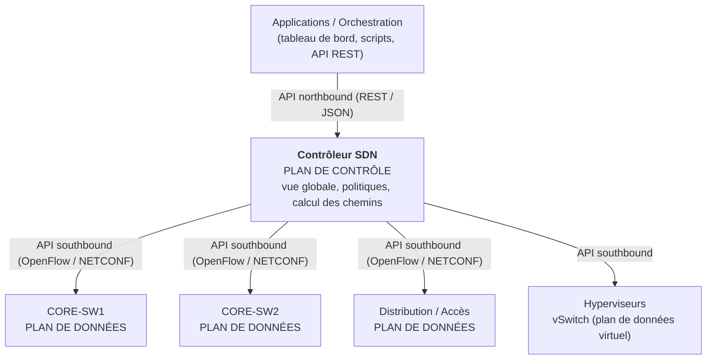

# CDC-13 — Virtualisation des serveurs et ouverture vers le cloud hybride

**Client :** NovaTrans Romandie SA (siège et plateforme de tri à Genève, agence à Lausanne, dépôt à Sion)
**Prestataire :** Satom IT & Learning Solutions
**Besoin couvert :** B5 — Serveurs virtualisés et ouverture vers le cloud
**Formation :** Geneva Institute of Technology — TP Final modules 9 à 14 (CFCI2, 2026-2027)
**Auteur :** Marcus

> **Mention IA :** une IA générative a été utilisée comme aide à la rédaction de ce rapport, conformément aux consignes. Les manipulations (VM de test, snapshot, restauration) ont été réalisées et vérifiées par l'étudiant ; les captures sont les siennes.
>
> **Données inventées :** le sujet ne fournit pas certaines informations. Les choix du prestataire sont regroupés dans le tableau ci-dessous.

| Donnée | Valeur retenue | Pourquoi |
|---|---|---|
| Hyperviseur proposé | Proxmox VE, cluster de 2 nœuds | Libre, cluster et haute disponibilité inclus, pas de licence |
| VLAN 70 | Serveurs applicatifs | Le sujet cite VLAN 60 et 70 sans définir le 70 |
| VLAN de gestion | VLAN 99 | Aucun VLAN de gestion n'est donné |
| Plateforme de la VM de test | Ubuntu sous WSL2 | Snapshot simulé par export/import (voir 4.1) |

---

## Sommaire

1. [Contexte et objectifs](#1-contexte-et-objectifs)
2. [Comparatif des hyperviseurs](#2-comparatif-des-hyperviseurs)
3. [Plan de vSwitch](#3-plan-de-vswitch)
4. [VM Linux de test : snapshot, modification, restauration](#4-vm-linux-de-test--snapshot-modification-restauration)
5. [Architecture SDN : plan de contrôle et plan de données](#5-architecture-sdn--plan-de-contrôle-et-plan-de-données)
6. [Feuille de route vers le cloud hybride](#6-feuille-de-route-vers-le-cloud-hybride)
7. [Fiche de synthèse client](#7-fiche-de-synthèse-client)
8. [Livrables et arborescence du dépôt](#8-livrables-et-arborescence-du-dépôt)

---

## 1. Contexte et objectifs

Les serveurs de la plateforme de tri de Genève tournent sur du matériel physique vieillissant. NovaTrans souhaite :

- virtualiser son infrastructure sur **deux hyperviseurs** ;
- préparer la **sauvegarde vers le cloud** ;
- étudier une évolution vers une **gestion SDN** du datacenter.

**Contrainte du client :** pas de remplacement de liaison WAN ; la solution passe par la configuration. Chaque mission doit produire une solution testable avant la mise en production.

**Nature des livrables.** Ce cahier combine une partie **pratique** et des parties de **conception documentaire** :

| Section | Nature |
|---|---|
| 2. Comparatif des hyperviseurs | Étude (rédaction) |
| 3. Plan de vSwitch | Conception (plan, aucune mise en œuvre) |
| 4. VM de test, snapshot, restauration | **Réalisé et prouvé par captures** |
| 5. Architecture SDN | Conception (schéma) |
| 6. Feuille de route cloud | Étude (rédaction) |

---

## 2. Comparatif des hyperviseurs

| Critère | Type 1 (bare-metal) | Type 2 (hébergé) |
|---|---|---|
| Installation | Directement sur le matériel | Au-dessus d'un système d'exploitation hôte |
| Exemples | VMware ESXi, Proxmox VE, Hyper-V | VMware Workstation, VirtualBox |
| Performances | Élevées, accès direct au matériel | Réduites par la couche OS hôte |
| Haute disponibilité | Cluster, redémarrage automatique des VM, migration à chaud | Limitée à l'état du poste hôte |
| Surface d'attaque | Réduite (système minimal dédié) | Plus large (OS généraliste) |
| Usage typique | Datacenter, production | Test, développement, formation |

### Recommandation

**Hyperviseur de type 1** pour le datacenter de NovaTrans.

**Justification :** la plateforme de tri ne tolère aucune coupure pendant les heures de tri (besoin métier du client). Seul un type 1 permet un **cluster à deux nœuds** avec redémarrage automatique des machines virtuelles sur le nœud survivant et migration à chaud pour les maintenances. Le type 2 dépend d'un OS hôte généraliste (mises à jour, redémarrages) et ne convient pas à de la production ; il reste adapté aux maquettes, comme dans ce TP.

**Solution proposée :** Proxmox VE, cluster de deux nœuds avec stockage partagé (donnée inventée, voir tableau en tête de document).

---

## 3. Plan de vSwitch

VLAN 60 = sauvegardes et partages de fichiers (défini dans le sujet) ; VLAN 70 = serveurs applicatifs et VLAN 99 = gestion (données inventées, voir tableau en tête de document).

| Élément | Hyperviseur 1 | Hyperviseur 2 |
|---|---|---|
| vSwitch | vSwitch0 | vSwitch0 |
| Uplinks | 2 cartes réseau en LACP (nic0, nic1) | 2 cartes réseau en LACP (nic0, nic1) |
| Groupe de ports « SRV-APP » | VLAN 70 | VLAN 70 |
| Groupe de ports « SAUV-FICHIERS » | VLAN 60 | VLAN 60 |
| Groupe de ports « MGMT » | VLAN 99 | VLAN 99 |

Configuration côté commutateur pour l'agrégation LACP d'un hyperviseur (noms d'interfaces à adapter à la maquette) :

```
interface range GigabitEthernet0/1 - 2
 channel-group 1 mode active
!
interface Port-channel1
 switchport mode trunk
 switchport trunk allowed vlan 60,70
```

**Point d'attention :** un LACP réparti sur **deux commutateurs différents** exige un empilage ou du MLAG. Sans cela, chaque hyperviseur se raccorde en LACP à un seul commutateur logique, ou utilise un mode actif/passif vers deux commutateurs.

---

## 4. VM Linux de test : snapshot, modification, restauration

### 4.1 Choix de la plateforme

*Choix de l'étudiant (donnée inventée, voir tableau en tête de document).* La VM de test est une instance **Ubuntu sous WSL2**. WSL2 s'exécute dans une machine virtuelle légère reposant sur la technologie d'hyperviseur de Windows (Hyper-V). Elle permet de démontrer le cycle snapshot → modification → restauration sur un système Linux virtualisé.

WSL2 n'a pas de bouton « snapshot » natif. La fonction est assurée par :

- `wsl --export` : image figée de l'état du système (fichier `.tar`) ;
- `wsl --import` : retour à cet état.

En production, on utiliserait les snapshots natifs de l'hyperviseur de type 1 recommandé en section 2.

### 4.2 Déroulement

| Étape | Action | Preuve |
|---|---|---|
| 1. État de départ | `~/test.txt` contient « avant snapshot », aucun autre fichier |  |
| 2. Snapshot | `wsl --terminate Ubuntu`, puis `wsl --export Ubuntu C:\snap\avant-modification.tar` (1 273 456 640 octets) |  |
| 3. Modification | `test.txt` réécrit avec « apres modification » ; ajout de `fichier-a-supprimer.txt` |  |
| 4. Restauration | `wsl --unregister Ubuntu`, puis `wsl --import Ubuntu C:\wsl\Ubuntu C:\snap\avant-modification.tar` |  |
| 5. Vérification | `cat ~/test.txt` affiche « avant snapshot » ; `ls ~` ne montre plus `fichier-a-supprimer.txt` |  |

### 4.3 Commandes utilisées

Dans Ubuntu :

```bash
echo "avant snapshot" > ~/test.txt     # état de départ
cat ~/test.txt && ls ~
```

Dans PowerShell (snapshot) :

```powershell
mkdir C:\snap
wsl --terminate Ubuntu
wsl --export Ubuntu C:\snap\avant-modification.tar
dir C:\snap
```

Dans Ubuntu (modification) :

```bash
echo "apres modification" > ~/test.txt
touch ~/fichier-a-supprimer.txt
cat ~/test.txt && ls ~
```

Dans PowerShell (restauration), puis vérification dans Ubuntu :

```powershell
wsl --unregister Ubuntu
mkdir C:\wsl
wsl --import Ubuntu C:\wsl\Ubuntu C:\snap\avant-modification.tar
wsl -d Ubuntu -u marcus
```

```bash
cat ~/test.txt && ls ~
```

### 4.4 Analyse

La restauration ramène le système exactement à l'état figé à l'étape 2 : le contenu modifié est annulé et le fichier ajouté disparaît. Un snapshot avant toute intervention risquée (mise à jour, changement de configuration) offre ainsi un retour arrière en quelques minutes, sans réinstallation.

**Limites :**
- Le snapshot WSL est une copie **complète** du disque (1,2 Go ici), alors qu'un snapshot d'hyperviseur n'enregistre que les différences.
- Le fichier `.tar` est stocké sur le même poste : ce n'est **pas** une sauvegarde externe.
- Le snapshot ne remplace pas la sauvegarde cloud prévue en section 6.

---

## 5. Architecture SDN : plan de contrôle et plan de données

### 5.1 Principe

Le SDN (Software-Defined Networking) sépare :

| Plan | Rôle | Où il s'exécute |
|---|---|---|
| **Plan de contrôle** | Décider : routage, politiques, topologie | Centralisé, dans le **contrôleur SDN** |
| **Plan de données** | Exécuter : transférer les trames/paquets selon les décisions reçues | Dans chaque commutateur / routeur |

### 5.2 Schéma



### 5.3 Rôles

- **Contrôleur SDN :** possède la vue globale du réseau, calcule les chemins, applique les politiques (VLAN, QoS, ACL) de manière centralisée, puis les « pousse » aux équipements.
- **API southbound (contrôleur → équipements) :** **OpenFlow** est le protocole standard historique ; des API équivalentes existent (NETCONF/RESTCONF, API propriétaires comme Cisco ACI ou DNA Center).
- **API northbound (applications → contrôleur) :** API REST, qui permettra au tableau de bord de NovaTrans de lire l'état du réseau.
- **Équipements :** ne gardent que le plan de données ; ils appliquent les règles de transfert reçues.

### 5.4 Intérêt pour NovaTrans

| Besoin du client | Apport du SDN |
|---|---|
| Réduction des erreurs de configuration | Politique définie une fois, appliquée partout |
| Extension (+40 postes, +12 bornes Wi-Fi) | Provisionnement centralisé, sans intervention sur chaque équipement |
| Documentation à jour pour l'audit | Le contrôleur connaît la topologie réelle |
| Remise en service rapide | Vue globale facilitant le diagnostic |

**Réserve :** le SDN ajoute un point de défaillance (le contrôleur). Il doit être déployé en **cluster redondant**, et les équipements doivent continuer à transférer le trafic si le contrôleur est indisponible.

---

## 6. Feuille de route vers le cloud hybride

### 6.1 Objectif

Préparer la **sauvegarde vers le cloud** et poser les bases d'une évolution hybride, **sans remplacer les liaisons WAN** existantes.

### 6.2 Choix du modèle : IaaS pour la sauvegarde

| Modèle | Description | Pertinence pour NovaTrans |
|---|---|---|
| **IaaS** | Infrastructure virtualisée louée (serveurs, stockage, réseau) | **Retenu** : stockage objet pour les sauvegardes, VM de secours |
| SaaS | Application complète fournie comme service | Pour la messagerie ou le CRM, dans un second temps |
| Cloud privé | Infrastructure dédiée à une seule organisation | C'est le datacenter virtualisé de la section 2 |
| Cloud public | Infrastructure partagée louée à la demande | Cible de la sauvegarde externe |

Le résultat est un **cloud hybride** : production sur le datacenter virtualisé de NovaTrans, sauvegarde et secours sur un cloud public.

### 6.3 Étapes de migration

| Phase | Action | Livrable / critère de réussite |
|---|---|---|
| **1. Préparation** | Inventaire des serveurs et classification des données ; choix du fournisseur (hébergement en Suisse ou UE, cf. conformité) | Inventaire validé |
| **2. Virtualisation** | Mise en place des deux hyperviseurs, vSwitch, snapshots (sections 2 à 4) | VM de production opérationnelles |
| **3. Connectivité sécurisée** | Tunnel **VPN IPsec site-à-site** entre le siège et le cloud | Tunnel établi, trafic chiffré |
| **4. Sauvegarde cloud** | Sauvegardes nocturnes chiffrées vers le stockage cloud, limitées en débit | Restauration test réussie |
| **5. Secours** | VM de reprise d'activité dans le cloud pour les services critiques (ERP) | Test de bascule documenté |
| **6. Évolution** | Étude SDN et automatisation | Décision du client |

### 6.4 Points de sécurité

| Risque | Mesure |
|---|---|
| Interception des données en transit | VPN IPsec ; TLS pour les accès web/API |
| Fuite des données stockées | **Chiffrement des sauvegardes avant envoi**, clés gérées par NovaTrans |
| Accès non autorisé au cloud | Authentification forte (MFA), principe du moindre privilège, comptes nominatifs |
| Perte de maîtrise des données | Localisation des données (Suisse/UE), clauses contractuelles, conformité à la LPD |
| Dépendance au fournisseur | Format de sauvegarde ouvert, test de restauration régulier |
| Saturation du WAN | Limitation du débit des sauvegardes et planification en heures creuses |
| Absence de traçabilité | Journalisation centralisée des accès |

### 6.5 Recommandation

Démarrer par la **sauvegarde chiffrée en IaaS**, la moins risquée et la plus utile (elle répond directement à la continuité de production), puis étendre au secours des services critiques une fois la restauration éprouvée.

---

## 7. Fiche de synthèse client

**NovaTrans Romandie SA — Mission CDC-13 : virtualisation et cloud**

**Votre besoin.** Remplacer vos serveurs vieillissants par une infrastructure virtualisée fiable, préparer la sauvegarde dans le cloud et étudier une gestion plus automatisée du réseau.

**Notre recommandation.**
1. **Virtualiser sur deux hyperviseurs de type 1** formant un cluster. Si un serveur tombe en panne, les machines virtuelles redémarrent automatiquement sur l'autre : pas de coupure pendant les heures de tri.
2. **Connecter les serveurs virtuels au réseau avec deux liaisons agrégées par hyperviseur** : plus de débit, et une liaison peut tomber sans interrompre le service. Les flux sont séparés par VLAN (sauvegardes, applications).
3. **Sauvegarder vers un cloud public**, avec des sauvegardes chiffrées envoyées la nuit via un tunnel sécurisé, sans toucher à vos liaisons WAN.
4. **Étudier le SDN** dans un second temps : une gestion centralisée du réseau réduirait les erreurs de configuration et accélérerait l'ajout de vos 40 postes et 12 bornes Wi-Fi.

**Ce que nous avons vérifié.** Sur une machine de test, nous avons figé son état (« snapshot »), modifié son contenu, puis restauré l'état initial : le retour arrière fonctionne et prend quelques minutes. Il sera systématique avant chaque intervention sur vos serveurs.

**Précautions.**
- Un snapshot n'est **pas** une sauvegarde : il reste sur le même serveur.
- Les sauvegardes dans le cloud doivent être **chiffrées** et leur restauration **testée** régulièrement.
- Un contrôleur SDN doit être **redondant**, sinon il devient un point de défaillance.

**Prochaines étapes.** Valider le choix de l'hyperviseur et le plan de VLAN, puis lancer une phase pilote de sauvegarde cloud.

---

## 8. Livrables et arborescence du dépôt

| Livrable demandé | Emplacement |
|---|---|
| Comparatif des hyperviseurs | [Section 2](#2-comparatif-des-hyperviseurs) |
| Plan de vSwitch | [Section 3](#3-plan-de-vswitch) |
| Preuve de snapshot et restauration | [Section 4](#4-vm-linux-de-test--snapshot-modification-restauration) + `captures/` |
| Schéma plan de contrôle / plan de données | [Section 5](#5-architecture-sdn--plan-de-contrôle-et-plan-de-données) |
| Feuille de route cloud | [Section 6](#6-feuille-de-route-vers-le-cloud-hybride) |
| Fiche de synthèse client | [Section 7](#7-fiche-de-synthèse-client) |

```
CDC-13/
├── README.md
└── captures/
    ├── 01-etat-depart.png
    ├── 02-snapshot.png
    └── 03-modification-restauration.png
```
